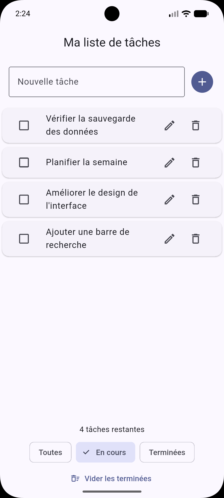

# todo_bloc

Application de liste de tâches en Flutter, avec l'état géré par `flutter_bloc`
(TP BLOK, octobre 2026).

## Lancement

```bash
flutter pub get
flutter run
```

Tests et qualité :

```bash
flutter test
flutter analyze
dart format 
```

## Fonctionnalités
|_________________________________________________________________________|
| Réf.| Fonctionnalité                                                    |
|_____|___________________________________________________________________|
| F1  | Ajouter une tâche (titre nettoyé, titre vide ignoré)              |
| F2  | Cocher / décocher (tâche terminée barrée et grisée)               |
| F3  | Supprimer par glissement ou par l'icône corbeille                 |
| F4  | Modifier le titre : un appui sur la tâche ouvre l'écran d'édition |
| F5  | Filtrer : Toutes, En cours, Terminées                             |
| F6  | Compteur « N tâche(s) restante(s) »                               |
| F7  | Vider les tâches terminées                                        |
| F8  | Message quand la liste visible est vide                           |
|_____|___________________________________________________________________|


Bonus :

- Persistance: `HydratedBloc`, les tâches survivent au redémarrage.
- Annuler: le SnackBar « Tâche supprimée » propose « Annuler » et remet
  la tâche à sa position.
- Thème sombre: l'app suit le réglage du téléphone (`ThemeMode.system`).

## Architecture

```
lib/
├── main.dart                     # thème + BlocProvider au-dessus de MaterialApp
└── todos/
    ├── models/todo.dart
    ├── bloc/
    │   ├── todos_bloc.dart
    │   ├── todos_event.dart
    │   └── todos_state.dart
    └── view/
        ├── todos_page.dart       # écran principal + BlocListener (SnackBar)
        ├── todo_edit_page.dart   # écran d'édition (F4)
        └── widgets/
            ├── todo_input.dart
            ├── todo_list.dart
            ├── todo_tile.dart
            └── todos_footer.dart # compteur, filtres, « vider »
test/
└── todos/bloc/todos_bloc_test.dart
```

## Captures d'écran

[Liste remplie](docs/screenshots/liste.png) |  |

## Ce que j'ai appris / ce qui m'a bloqué

1. En Flutter, tout est widget : découper l'écran en petits widgets (une ligne,
   le pied de page, le champ de saisie) rend le code beaucoup plus lisible.
2. Avec `setState`, la liste et les fonctions passaient de widget en widget par
   paramètres ; Bloc règle ce problème : l'interface envoie un événement, le Bloc
   émet un nouvel état.
3. J'ai appris la différence entre `context.read` (envoyer un événement) et
   `BlocBuilder` (afficher un état), et pourquoi le SnackBar va dans un
   `BlocListener`.
4. Ce qui m'a bloqué : la gestion d'état. Comprendre le circuit événement →
   gestionnaire → nouvel état, et passer de `setState` à Bloc, m'a pris du temps.
5. Autre blocage : la persistance. Mettre en place `HydratedBloc` (stockage,
   `toJson` / `fromJson`) pour que les tâches survivent au redémarrage.
